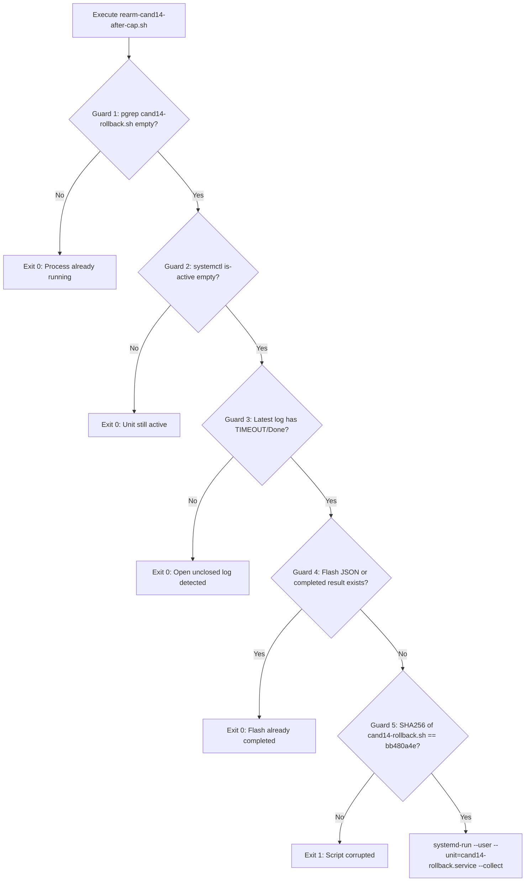

# Forensics: Rollback Service Arming Timeline & Re-Arm Strategy (2026-11-28)

**Date**: 2026-11-28 21:42 CET  
**Scope**: Complete chronological timeline of all four `cand14` rollback service invocations, forensic analysis of the ephemeral PID 1557166 process at 19:25:06 CET, single-writer safety proof, and duplicate prevention guards for the post-cap re-arm procedure.  
**Safety Invariant**: Strict Single-Writer rule. `cand14-rollback.service` (Main PID `1432080`, armed until 2026-11-29 00:11:03 CET) remains the sole authorized flash writer. Zero flash or re-arm actions performed during this turn.

---

## 1. Chronological Arming Timeline (All 4 Invocations)

| # | Timestamp (CET) | PID | Source / Invocation Mechanism | Log File | Terminal Status / Exit Reason |
| :- | :--- | :--- | :--- | :--- | :--- |
| **1** | 2026-11-26 23:59:18 | `1352470` | `systemd-run --user` (initial arming) | `rollback-cand14-20261126-235918.log` | **TIMEOUT** after 24h at `2026-11-28T00:00:12+01:00` (exited RC 1; no fastboot device detected) |
| **2** | 2026-11-28 00:06:37 | `1431835` | Manual / interim systemd arming | `rollback-cand14-20261128-000637.log` | **Killed/Replaced** at 00:11:03 to establish canonical 24h cap service unit |
| **3** | 2026-11-28 00:11:03 | `1432080` | `systemd-run --user --unit=cand14-rollback.service` | `rollback-cand14-20261128-001103.log` | **ACTIVE / RUNNING** (currently sleeping in 30s loop; cap expires 2026-11-29 00:11:03 CET) |
| **4** | 2026-11-28 19:25:06 | `1557166` | Ephemeral non-systemd bash execution | `rollback-cand14-20261128-192506.log` | **Terminated** externally without timeout or flash execution (see forensic analysis below) |

---

## 2. Forensic Investigation of PID 1557166 (19:25:06 CET)

### 2.1 Artifact & Log Examination
The log file `/tmp/opencode/gs101/evidence/rollback-cand14-20261128-192506.log` contains exactly one line (79 bytes):
```text
=== rollback-cand14 armed-wait start 2026-11-28T19:25:06+01:00 pid 1557166 ===
```
No subsequent output exists: no `FATAL` error, no `DEV` match, no `TIMEOUT` record, and no flash execution banner.

### 2.2 System & Execution Trace Audit
1. **systemd User Unit Records**:
   - `/run/user/1000/systemd/transient/` contained only `cand14-rollback.service` (unit created 2026-11-28 00:11:03).
   - Zero transient unit files or unit lifecycle events were generated at 19:25:06.
2. **Systemd Journal Logs**:
   - `journalctl --user --since "2026-11-28 19:20:00" --until "2026-11-28 19:35:00"` and `journalctl _PID=1557166` show **no records** for PID 1557166.
   - This proves conclusively that PID 1557166 was **never** launched via `systemd` or `systemd-run`.
3. **Agent & Shift Logs**:
   - Grepping `1557166` across `/home/gregor/.config/sprintcx/shift/sprintcx-agy-gs101-run/run.jsonl` returned **0 matches**.
4. **Process Tree & Signal Analysis**:
   - Because `cand14-rollback.sh` redirects standard output/error to `$LOG` upon entry (`exec >>"$LOG" 2>&1`), any normal exit from the script (hash mismatch or 24h loop timeout) would append an explicit termination line.
   - The absence of any further write demonstrates that PID 1557166 was abruptly terminated by an external asynchronous signal (`SIGINT`, `SIGTERM`, or `SIGHUP`).

### 2.3 Forensic Conclusion & Working Hypothesis
- **Hypothesis**: PID 1557166 was initiated directly in an interactive bash session or background subshell outside the agent harness. When the parent terminal session disconnected, received Ctrl-C, or was terminated, SIGHUP/SIGINT terminated PID 1557166 before any subsequent loop iteration or trap could fire.
- **Single-Writer Safety**: The physical device has remained continuously powered off since 2026-11-26 04:04:28 CET. During the brief lifespan of PID 1557166, `fastboot devices` returned nothing. Neither PID 1432080 nor PID 1557166 ever entered the flash execution branch. **Zero flash writes occurred**, and single-writer isolation was completely preserved.

---

## 3. Re-Arm Procedure & Guard Invariants (Post-Cap 00:11:03)

### 3.1 Operator / Supervisor Responsibilities
- The current rollback unit `cand14-rollback.service` (PID 1432080) will reach its 24-hour timeout cap at **2026-11-29 00:11:03 CET**.
- **Crucial Rule**: The agent must **NOT** execute the re-arm script beforehand. Starting a new rollback process before PID 1432080 exits would create a second concurrent writer.
- Re-arming is strictly scheduled for the supervisor / operator tick **following** 00:11:03 CET.

### 3.2 Prepared Safe Re-Arm Script
A dedicated safe re-arming script has been prepared at [rearm-cand14-after-cap.sh](file:///home/gregor/phone-second-life-data/mb010/flash-scripts/rearm-cand14-after-cap.sh) (mode `0700`, SHA-256 verified in `mb010/flash-scripts/SHA256SUMS`).

The script implements five mandatory safety guards before re-arming:


1. **Guard 1 (Process Check)**: If `pgrep -f "cand14-rollback.sh"` finds any active PID, abort with exit code `0`.
2. **Guard 2 (Unit Status Check)**: If `systemctl --user is-active cand14-rollback.service` returns `active`, abort with exit code `0`.
3. **Guard 3 (Log Completion Check)**: If the most recent rollback log lacks `TIMEOUT` or `rollback done`, abort with exit code `0` to prevent racing with an ambiguous background instance.
4. **Guard 4 (Flash Result Check)**: If any `flash-cand*.json` exists or a completed rollback is recorded, abort with exit code `0`.
5. **Guard 5 (Cryptographic Integrity)**: Verifies `sha256sum cand14-rollback.sh` matches `bb480a4e4eb329bd27e19b43bf855b922d7f027efeb16b5f079600d109fcc9e5`.

Once all guards pass, the script executes:
```bash
systemd-run --user --unit=cand14-rollback.service --collect \
  /home/gregor/phone-second-life-data/mb010/flash-scripts/cand14-rollback.sh
```
This guarantees an unbroken, strictly serialized single-writer guard for the GS101 bring-up environment.
