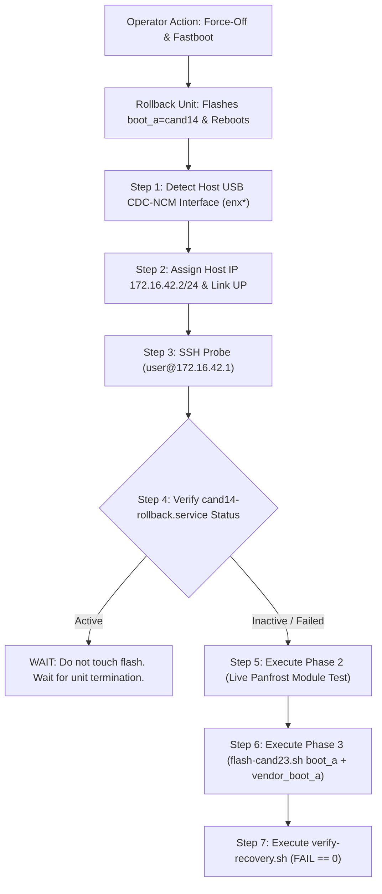

# Issue #11 GPU: Post-Recovery Trigger Checklist

**Date**: 2026-11-28  
**Scope**: Host-side detection and activation trigger sequence for operator physical recovery (Power + VolDown).  
**Complementary Document**: [post-recovery-runbook.md](file:///home/gregor/github_repos/linux-google-gs101/Documentation/gs101/evidence/issue11-gpu/post-recovery-runbook.md)

---

## 1. Safety Invariants & Flash Writer Guard

- **Current State**: Device remains powered off since 2026-11-26 04:04:28.
- **Single Flash Writer Rule**: `cand14-rollback.service` (Main PID `1432080`, armed wait until 2026-11-29 00:11:03) is the **sole authorized flash writer** on the host.
- **Prohibition**: Never execute `fastboot flash`, `flash-cand20.sh`, `flash-cand21.sh`, `flash-cand22.sh`, `flash-cand23.sh`, or any secondary flash utility while `cand14-rollback.service` is active.
- **Permanent Artifact Roots**: Canonical flash images and deployment bundles are stored under `/home/gregor/phone-second-life-data/mb010/` (documented in [durable-artifact-layout-20261128.md](file:///home/gregor/github_repos/linux-google-gs101/Documentation/gs101/evidence/issue10-image/durable-artifact-layout-20261128.md)). If `/tmp` is empty following a host reboot, run `./Documentation/gs101/tests/build-deploy-bundle.sh` to reconstitute the bundle.

---

## 2. Sequential Recovery Trigger Checklist

Execute these checks in strict sequence upon device re-attachment:



### Step 1: Detect Host USB CDC-NCM Network Interface (`enx*`)
Verify that the kernel creates the USB network interface upon device boot:
```bash
ip -o link show | grep -E 'enx[0-9a-f]+'
```

### Step 2: Configure Host IP Address (`172.16.42.2/24`)
Assign static host IP to the detected interface and bring it up:
```bash
for iface in $(ip -o link show | awk -F': ' '{print $2}' | grep -E '^enx'); do
    sudo ip addr add 172.16.42.2/24 dev "$iface" 2>/dev/null || true
    sudo ip link set "$iface" up 2>/dev/null || true
done
```

### Step 3: Probe Target SSH Connectivity (`172.16.42.1`)
Verify that SSH responds on the target device:
```bash
ssh -i ~/.ssh/id_ed25519 -o UserKnownHostsFile=/tmp/opencode/gs101/issue4/known_hosts \
    -o BatchMode=yes -o StrictHostKeyChecking=yes -o ConnectTimeout=3 \
    user@172.16.42.1 'echo ONLINE'
```

### Step 4: Verify Termination of Rollback Service
Verify that `cand14-rollback.service` has executed its single-shot flash and completed:
```bash
systemctl --user is-active cand14-rollback.service
```
- **Prerequisite**: Output **MUST** be `inactive` or `failed`.
- If output is `active`, **STOP**. Do not proceed to manual flashing.

### Step 5: Proceed with Runbook Phase 2 (Live Module Test)
Once Steps 1–4 pass:
1. Transfer `gpu-sched.ko` and `panfrost.ko` to `/tmp/` on the target.
2. Load modules with `sudo insmod`.
3. Verify `/dev/dri/renderD128` and evaluate `dmesg`.

### Step 6: Execute Phase 3 (Consolidated `flash-cand23.sh`)
Only after Phase 2 confirms zero kernel panics and valid G78 detection:
```bash
/tmp/opencode/gs101/flash-cand23.sh
```
Consolidated path: flashes `boot_a` (`cand22` modular Panfrost + `CONFIG_PCI_EXYNOS=m`) and `vendor_boot_a` (`cand23` with PCIe RC1 `pcie@14520000` + USI16/UART16 BT DTB). This covers both Issue #11 (GPU) and Issue #8 (WLAN/BT) in a single flash step. *(Note: `flash-cand20.sh` and `flash-cand21.sh` remain available as isolation/fallback paths if isolated GPU-only or BT-only DTB testing is required)*. Followed by Phase 4 (Boot Verification) and Phase 5 (Issue #10 Application Persistence).

### Step 7: Acceptance Verification (`verify-recovery.sh, alle FAIL==0`)
Following Candidate 23 flash, persistent GPU module activation (`install-gpu.sh`), and application staging (`install-apps.sh`), run the consolidated host-side acceptance test:
```bash
Documentation/gs101/tests/verify-recovery.sh
# (Note: /tmp/opencode/gs101/verify-recovery.sh copy remains valid until next clean checkout)
```
- **Prerequisite for acceptance**: Script must complete with zero failures (`FAIL == 0`).
- Generates structured audit evidence at `/tmp/opencode/gs101/evidence/verify-recovery-<timestamp>.json` confirming *Flash != Boot != Bild != Touch != GPU != Apps*.
