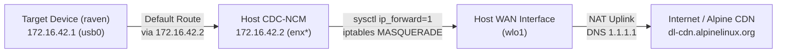

# Issue #7: Controlled Multitouch Test Protocol & Host-NAT Setup

**Date**: 2026-11-28  
**Scope**: Host-NAT deployment and controlled multitouch quality test suite for Google Pixel 6 Pro (`raven`, GS101).  
**Complementary Tools**:
- [gs101-nat-setup.sh](file:///home/gregor/github_repos/linux-google-gs101/Documentation/gs101/tests/gs101-nat-setup.sh)
- [touchmt-test.sh](file:///home/gregor/github_repos/linux-google-gs101/Documentation/gs101/tests/touchmt-test.sh)
- [touchmon.sh](file:///home/gregor/github_repos/linux-google-gs101/Documentation/gs101/tests/touchmon.sh)
- [install-apps.sh](file:///tmp/opencode/gs101/wlan-bundle/install-apps.sh)

---

## 1. Executive Summary & Problem Statement

Issue #7 addresses two primary operational milestones on `raven`:
1. **Host-NAT Gateway for Device Uplink**: The target device requires outbound internet access over the USB CDC-NCM gadget interface (`usb0`, `172.16.42.1`) routed through the host (`172.16.42.2`). While previous documentation noted manual `iptables` entries, no idempotent, automated host-side configuration script existed.
2. **Controlled Multitouch Verification Protocol**: While raw logging existed via `touchmon.sh` and prior low-level kernel fixes resolved driver defects (removal of conflicting `BTN_TOOL_FINGER` emissions and SPI retry delays in `sec_ts.c`), there was no standardized, reproducible measurement suite to validate touch positional accuracy, tracking jitter, cadence, and ghost-touch immunity against Issue #7 acceptance criteria.

---

## 2. Host-NAT Gateway Architecture & Coupling



### 2.1 Automated Host-Side Setup (`gs101-nat-setup.sh`)
The script [gs101-nat-setup.sh](file:///home/gregor/github_repos/linux-google-gs101/Documentation/gs101/tests/gs101-nat-setup.sh) provides an idempotent mechanism on the host:
- **IP Forwarding**: Verifies `net.ipv4.ip_forward=1` and persists the configuration in `/etc/sysctl.d/99-gs101-nat.conf`.
- **Iptables Masquerade**: Checks before adding the rule to avoid duplicate chains:
  ```bash
  iptables -t nat -A POSTROUTING -s 172.16.42.0/24 -o wlo1 -j MASQUERADE
  ```
- **Forwarding Rules**: Ensures bidirectional forwarding between the CDC-NCM subnet and host outbound WAN interface (`wlo1` or auto-detected default route).

### 2.2 Target Coupling with `install-apps.sh`
When the target boots into Candidate 23 and executes [install-apps.sh](file:///tmp/opencode/gs101/wlan-bundle/install-apps.sh):
1. The target sets its persistent default route:
   ```bash
   /sbin/ip route replace default via 172.16.42.2 dev usb0
   ```
2. Configures DNS servers `1.1.1.1` and `1.0.0.1` in `/etc/systemd/resolved.conf.d/dns.conf`.
3. Through the host NAT setup, the device can immediately execute `apk update && apk add ...` directly against official Alpine package repositories, falling back to local SCP sideloading only if the host WAN uplink is disabled.

---

## 3. Controlled Multitouch Test Suite (`touchmt-test.sh`)

The test script [touchmt-test.sh](file:///home/gregor/github_repos/linux-google-gs101/Documentation/gs101/tests/touchmt-test.sh) targets `/dev/input/event1` (`sec_touchscreen` driven by Samsung S6SY792 on `spi0.0`) and interfaces with `libinput debug-events`.

### 3.1 Test Modules Overview

| Module Name | Purpose | Target Action | Acceptance Metric / Threshold |
| :--- | :--- | :--- | :--- |
| `grid9` | 9-Point Accuracy Grid | Operator taps 9 normalized points (corners, edges, center) | Mean positional error $\le 2.0\text{ mm}$ |
| `drag` | Trajectory & Cadence | Continuous horizontal and vertical drag | Report cadence $\sim 8.3\text{ ms}$ (~120 Hz); jitter $\sigma \le 1.0\text{ px}$ |
| `longpress` | Stationary Stability | Single contact held stationary for 10 s | Positional drift $\le 1.0\text{ mm}$; zero dropped contacts |
| `pinch` | Protocol B Multi-Touch | Two-finger pinch and spread gesture | Concurrent tracking of `ABS_MT_SLOT` 0 and 1; `BTN_TOOL_DOUBLETAP` |
| `ghost` | Idle Ghost-Touch Monitor | Device resting untouched for 300 s (5 min) | Strictly **0** spurious touch events |

### 3.2 9-Point Grid Specification (1440x3120 Panel)
Pixel 6 Pro panel dimensions are $1440 \times 3120\text{ px}$ across active area $72 \times 156\text{ mm}$ ($20\text{ px/mm}$ density):
- **P1 Top-Left**: (144 px, 312 px) $\rightarrow$ (7.2 mm, 15.6 mm)
- **P2 Top-Center**: (720 px, 312 px) $\rightarrow$ (36.0 mm, 15.6 mm)
- **P3 Top-Right**: (1296 px, 312 px) $\rightarrow$ (64.8 mm, 15.6 mm)
- **P4 Mid-Left**: (144 px, 1560 px) $\rightarrow$ (7.2 mm, 78.0 mm)
- **P5 Center**: (720 px, 1560 px) $\rightarrow$ (36.0 mm, 78.0 mm)
- **P6 Mid-Right**: (1296 px, 1560 px) $\rightarrow$ (64.8 mm, 78.0 mm)
- **P7 Bottom-Left**: (144 px, 2808 px) $\rightarrow$ (7.2 mm, 140.4 mm)
- **P8 Bottom-Center**: (720 px, 2808 px) $\rightarrow$ (36.0 mm, 140.4 mm)
- **P9 Bottom-Right**: (1296 px, 2808 px) $\rightarrow$ (64.8 mm, 140.4 mm)

---

## 4. Execution & Automated Evaluation

### 4.1 Running the Suite
On the live device:
```bash
# Execute complete multi-touch test suite
sudo /home/user/touchmt-test.sh all --output /tmp/touchmt-run1.tsv

# Or run individual modules as needed:
sudo /home/user/touchmt-test.sh grid9
sudo /home/user/touchmt-test.sh ghost --duration 300
```

### 4.2 Offline TSV Analysis
The script includes a built-in statistical analyzer that evaluates captured TSV data:
```bash
Documentation/gs101/tests/touchmt-test.sh analyze /tmp/touchmt-run1.tsv
```

### 4.3 Output Format
Captures are logged in TSV format:
```text
# Google Tensor GS101 Controlled Multi-Touch Test Dataset
# timestamp_sec	module	event	slot	x_px	y_px	x_mm	y_mm	major	minor	pressure
0.0100	grid9	DOWN	0	145.20	313.10	7.26	15.65	120	115	32
0.0180	drag	MOTION	0	200.50	500.10	10.02	25.00	120	115	32
...
```

### 4.4 Acceptance Criteria ("Done When" Matrix)
1. **Accuracy**: Mean Euclidean distance between target grid points and recorded taps $\le 2.0\text{ mm}$ ($40\text{ px}$).
2. **Smoothness / Jitter**: Standard deviation $\sigma \le 1.0\text{ px}$ during stationary hold; zero jagged velocity discontinuities during steady drag.
3. **Cadence**: Average motion report interval $8.3\text{ ms} \pm 1.5\text{ ms}$ (~120 Hz) confirming SPI read delay optimization (`delay_us=600`) operates without bus timeouts.
4. **Multitouch Handshake**: Concurrent activation of slots 0 and 1 with clean `BTN_TOOL_DOUBLETAP` assertion, satisfying Phoc/Phosh compositor gesture requirements.
5. **Noise Immunity**: Zero touches reported over 5 minutes of idle monitoring (`ghost` module).
