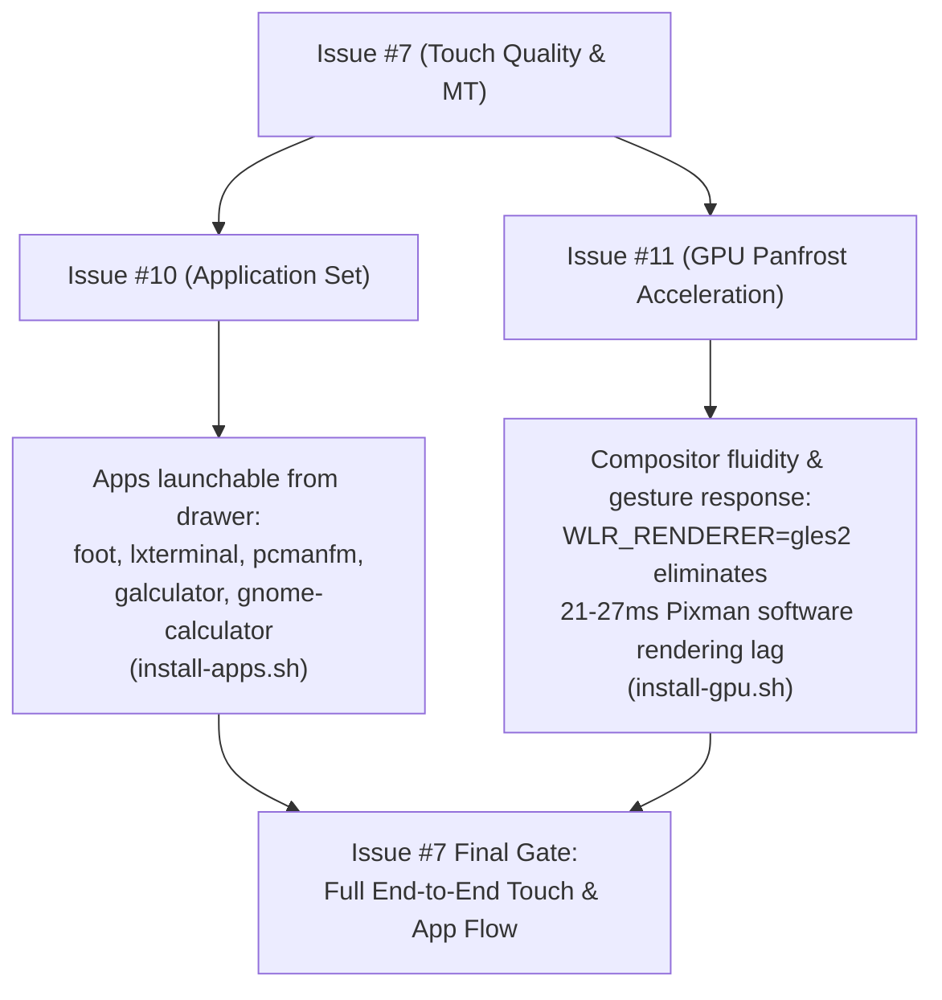

# Issue #7: Touch Multitouch Tooling & Implementation Status (2026-11-28)

**Date**: 2026-11-28  
**Scope**: Status assessment of Issue #7 tasks against recent offline commits, host NAT operational state, and remaining device/owner gates.  
**Baseline Commits**:
- [`9e11bff02`](https://github.com/omnipha/linux-google-gs101/commit/9e11bff02d48f7b8ef7e846228dc53249c8c43c2): `feat(tests): add host NAT setup and controlled multitouch test suite for issue 7`
- [`aa950f546`](https://github.com/omnipha/linux-google-gs101/commit/aa950f54621bb41ed8f71a2c13ec2b92cd54149d): `docs(gs101): document touch config cleanup and s6sy761 deactivation for issue 10`
- [`5d0dbfd0d`](https://github.com/omnipha/linux-google-gs101/commit/5d0dbfd0df219f3e56dc80b93f63d9a7c8b9277c): `docs(gs101): add acceptance verification and persistent app deployment runbooks`

---

## 1. Tooling Implementation Matrix (Issue #7 Tasks)

| Task | Scope & Requirement | Delivered Implementation | Status |
| :--- | :--- | :--- | :--- |
| **Task 1** | Host NAT on `usb0` (Default route `172.16.42.2`, DNS) | [gs101-nat-setup.sh](file:///home/gregor/github_repos/linux-google-gs101/Documentation/gs101/tests/gs101-nat-setup.sh) + Host system live state: `net.ipv4.ip_forward=1` persisted in `/etc/sysctl.d/99-gs101-nat.conf`; iptables NAT MASQUERADE `172.16.42.0/24 -> wlo1` active; bidirectional FORWARD rules verified. Device side: `install-apps.sh` configures persistent route via `172.16.42.2` and DNS `1.1.1.1`. | **Complete (Host-Verified)** |
| **Task 2** | Controlled MT test script (9-point grid, drag H/V, longpress, pinch) | [touchmt-test.sh](file:///home/gregor/github_repos/linux-google-gs101/Documentation/gs101/tests/touchmt-test.sh): Modules `grid9` (2mm accuracy threshold), `drag` (cadence ~8.3ms / 120Hz), `longpress` (10s hold drift), `pinch` (slots 0/1 concurrency), `ghost` (300s idle monitor). Logs structured TSV dataset. | **Complete (Tooling Ready)** |
| **Task 3** | Resolve multi-contact attribution (slot, major/minor, pressure) | `touchmt-test.sh` logs `slot`, `x_px`, `y_px`, `x_mm`, `y_mm`, `major`, `minor`, `pressure` per event; integrated analyzer evaluates slot concurrency and tracking IDs. | **Complete (Tooling Ready)** |
| **Task 4** | Fix timestamp base or prove harmless | In-tree fix in `sec_ts.c` (`ts->timestamp = ktime_get()`). Verification of continuous timestamp cadence in live libinput streams. | **Tooling Ready (Device-Gated)** |
| **Task 5** | Evidence documentation under `issue7-touch-mt/` | [mt-controlled-test-protocol.md](file:///home/gregor/github_repos/linux-google-gs101/Documentation/gs101/evidence/issue7-touch-mt/mt-controlled-test-protocol.md), [owner-test-protocol.md](file:///home/gregor/github_repos/linux-google-gs101/Documentation/gs101/evidence/issue7-touch-mt/owner-test-protocol.md), and this document. | **Complete** |

---

## 2. Gated Items (Device-Gated & Owner-Gated)

Because physical hardware remains powered off awaiting operator physical recovery, the following test actions cannot be executed autonomously and are explicitly gated:

### 2.1 Device-Gated Verification
- **Physical Test Suite Execution**: Running `sudo /home/user/touchmt-test.sh all --output /tmp/touchmt-run1.tsv` on live hardware to record real physical touches.
- **Timestamp Continuity**: Verifying zero timestamp wrapping glitches (`+4294967.293s`) on the first logged touch event across cold boot.
- **IRQ & Bus Timing Verification**: Confirming SPI burst delay (`delay_us=600`) sustains $\sim 8.3\text{ ms}$ report cadence without FIFO overruns under high contact counts.

### 2.2 Owner-Gated Physical Interaction
- **Bottom-Edge Swipe**: Physical thumb swipe from bezel ($Y \ge 2900$) upward to open Phosh lockscreen and overview drawer while natural palm grip rests on curved edges.
- **Application Launch from Drawer**: Tapping application icons once the drawer opens.

---

## 3. Explicit Inter-Issue Dependencies (Issue #10 & #11)

The "Done When" criteria of Issue #7 intersect directly with Issue #10 and Issue #11:

1. **Issue #10 (Rootfs & Applications)**:
   - *Finding*: "App drawer is empty... after swipe-up there is nothing to tap."
   - *Resolution*: Sideloading minimal application set (`foot`, `lxterminal`, `pcmanfm`, `galculator`, `gnome-calculator`) via `install-apps.sh` directly resolves the empty drawer, allowing full verification of application launching.
2. **Issue #11 (GPU Hardware Acceleration)**:
   - *Finding*: "Real UI feel (Pixman, 21-27 ms) vs touch pipeline."
   - *Resolution*: Software Pixman rasterization in Phoc introduced 21–27 ms of client latency behind touch events. Hardware acceleration via Panfrost Mali-G78 (`WLR_RENDERER=gles2` in Candidate 22/23) eliminates this rendering bottleneck, decoupling compositor frame pacing from kernel evdev latency.
